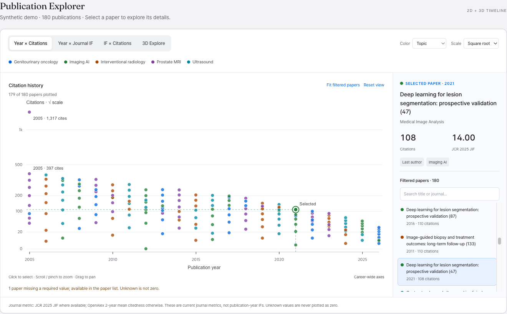
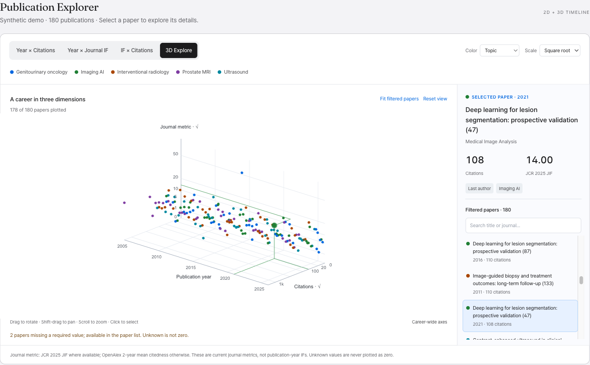

# Researcher Knowledge Graph

A single-page web app that visualizes one researcher's publication career: papers over time, co-author structure, topic evolution, and journal impact. No build tools, no backend, and no API key required.

**Live:** https://hwangsi.github.io/researcher-kg/

## Quick start

### Online (GitHub Pages)
Open https://hwangsi.github.io/researcher-kg/ and search for an author.

### Local
```bash
# Double-click index.html, or:
python3 -m http.server 8000
# then open http://localhost:8000
```

## Features

- **Author search** — name + institution + specialty keywords for disambiguation of common names
- **ORCID lookup** — the most accurate way to identify an author
- **Multi-ID merge** — OpenAlex sometimes splits one person across several IDs; merge them with checkboxes (split IDs discovered via ORCID are folded in automatically)
- **Optional OpenAlex API key** — without a key, everyone on your network shares OpenAlex's free daily limit. Enter your own [free key](https://openalex.org/settings/api-key) in the search form for 10× the budget. It stays in your browser and is sent only to OpenAlex.
- **3-stage works retrieval** — ORCID registry → OpenAlex → PubMed (see below)
- **Bubble Timeline** — year × journal × citations × topic, with authorship role (first / last / middle) encoded on each bubble
- **3D Timeline / Publication Explorer** — three 2D projections and an orthographic 3D view, with stable colors and scales, numerical axes, persistent paper details, and overlapping-point selection. [See views and controls below.](#publication-explorer)
- **Co-author Network** — D3 force-directed co-occurrence graph (focal author excluded by design)
- **Topic Streamgraph** — how research focus shifted over the years
- **Co-author Dot Plot** — co-author × year scatter, long-term vs one-shot collaborations
- **Journal table** — JCR Impact Factor with OpenAlex fallback (details below)
- **Paper list** — role filter, DOI/PubMed links, per-paper source badges (O = ORCID, P = PubMed/MeSH, ! = not in OpenAlex)

## Publication Explorer

Select an author, then open the **3D Timeline** tab. The explorer starts with **Year × Citations** and keeps the selected paper's details open as you switch views.

| View | Axes | Use it to |
|---|---|---|
| **Year × Citations** (default) | Publication year × paper citations | Find highly cited papers across a career |
| **Year × Journal IF** | Publication year × journal metric | Compare publication venues over time |
| **IF × Citations** | Journal metric × paper citations | Compare journal-level and paper-level citation metrics |
| **3D Explore** | X: year, Y: journal metric, Z: citations | Explore all three dimensions with numerical ticks and selection guides |

### Reading and selecting papers

- Each paper has an equal-sized mark; the selected paper is emphasized. **Color** switches between topic and authorship role. Topic colors are assigned from the author's full dataset and remain stable under filtering.
- **Scale** switches numeric axes between square-root scaling (default) and linear scaling. Tick labels always show original values; the year axis stays linear.
- Click a point or a paper-list entry to pin its title, journal, year, citations, authorship role, topic, and journal metric. Open the publication through the explicit DOI or PubMed link when available.
- Clicking overlapping or nearby points narrows the list to those papers. **Show all** restores the filtered list. Search matches titles and journal names in the list; it does not change the chart. **Show more papers** loads additional list entries.
- Selected points have coordinate guides in both 2D and 3D. If a filter hides the selected paper, its details stay open with an explanatory notice.

### Navigation and filters

| Action | 2D views | 3D Explore |
|---|---|---|
| Move the view | Drag to pan | Drag to rotate; Shift-drag to pan |
| Zoom | Scroll or pinch | Scroll |
| Fit | **Fit filtered papers** fits the current year, role, co-author, and legend filters | Same; also restores the initial camera angle |
| Reset | **Reset view** restores career-wide axes and resets zoom/pan | Same; also restores the initial camera angle |

The dashboard's year, authorship-role, and co-author filters apply to the explorer. Click a legend entry to isolate a topic or role within this view; click it again or choose **Show all** to clear that local filter. Career-wide axes remain fixed under filtering unless you explicitly fit them. Changing dashboard filters restores the career-wide scope. Resetting the view does not clear filters or the selected paper.

Unknown citations or journal metrics are never plotted as zero. Papers missing a citation count or journal metric remain in the filtered paper list, with a count explaining their omission from the chart. A genuine zero remains plotted. Journal details distinguish **JCR 2025 JIF** from **OpenAlex 2-year mean citedness**; these are current journal metrics, not the journal's IF in the paper's publication year.

On narrow screens, details and the paper list move below the chart. If 3D cannot initialize, the three 2D views and paper details remain available.

### Screenshots

These screenshots use **180 synthetic publications**, not a real researcher profile.





## How works are retrieved (3-stage pipeline)

1. **ORCID registry** (`pub.orcid.org`) — if the selected author has an ORCID, their self-curated publication list (DOIs/PMIDs) is fetched first. Highest precision; also catches papers filed under OpenAlex IDs the user didn't merge.
2. **OpenAlex** — the metadata core: citations, topics, authorship order, journals. Combines per-ID fetches, an `author.orcid` filter pass, and batch DOI hydration of ORCID-only papers.
3. **PubMed E-utilities** — keyed only on ORCID or DOIs (never name search, to avoid same-name contamination). Adds MeSH terms and recovers Medline-indexed papers missing from OpenAlex.

Each stage fails soft: if ORCID or PubMed is unavailable, the app continues with what it has. OpenAlex is the only required source.

## Impact Factor data

IF values come from two tiers, resolved per journal at runtime:

| Tier | Source | Coverage | UI marker |
|---|---|---|---|
| 1 | **JCR JIF** (Journal Citation Reports, Clarivate) | See below | plain value |
| 2 | **OpenAlex 2-year mean citedness** | Everything else | "OA" badge |

The OpenAlex fallback uses the same formula as the JIF (citations this year to items published in the previous two years) but a different citation database, so values are similar-but-not-identical to JCR.

### Why two JCR files?

Clarivate does not expose the JIF via any API, and the full JCR dataset is licensed — republishing all ~13,500 values would amount to redistributing it. So:

- **`data/jcr-if.js` / `data/jcr-if.json` (gitignored, local only)** — the full table, extracted from the yearly JCR report PDF with `extract_jcr.py`. Never committed.
- **`data/jcr-if-public.js` (committed)** — a small cited subset that the public build ships: the entire *Radiology, Nuclear Medicine & Medical Imaging* category (215 journals) plus ~26 major medical journals (NEJM, Lancet, JAMA, Nature, …), 418 ISSN keys total. Source attribution is in the file header.

`index.html` loads the full local table first (it 404s on the public build), then the public subset, which only assigns itself if nothing loaded. Journals outside the subset show the OpenAlex value with an "OA" badge.

`build_dist.py` always leaves out the full table, so `researcher-kg.html` only ships the public subset.

Current data: **JCR 2026 release (2025 JIF values)**.

### Yearly update

```bash
python extract_jcr.py <path-to-new-JCR-pdf>   # full local table (stays local)
python build_public_if.py                     # public subset (commit this one)
```

## Tech stack

| Library | Used for |
|---|---|
| Tailwind 3.4.17 browser build (`js/vendor/`) | UI utility classes |
| Chart.js | Bubble timeline, dot plot |
| D3 v7 | Co-author network, streamgraph, Publication Explorer's 2D projections |
| Three.js + OrbitControls | Publication Explorer's orthographic 3D view |
| OpenAlex API | Papers, authors, journals |
| ORCID Public API | Author-curated publication list |
| PubMed E-utilities | MeSH terms, Medline recall |

CDN scripts are pinned to exact versions and verified with `integrity` hashes. Tailwind's CDN doesn't allow those checks, so the repository keeps an unmodified copy.

## Build and validation

The modular app runs directly from `index.html`. To regenerate the single-file distributable after changing HTML, CSS, or JavaScript:

```bash
python3 build_dist.py
```

This updates `researcher-kg.html`, inlines local CSS/JS, and excludes the licensed full JCR table. Both entry points still load third-party libraries from CDNs and require network access for live publication data.

### Publication Explorer checks

The browser checks use deterministic synthetic publications and make no OpenAlex, ORCID, or PubMed requests. CDN access is still needed to load the app's libraries.

With **Ego Browser** installed, set `root` in `tests/explorer-checks.mjs` to your checkout's absolute path. Its `taskSpace` name must identify an agent-owned browser workspace; choose a new name if an earlier preview workspace has been handed back to the user. Run from the repository root:

```bash
ego-browser nodejs < tests/explorer-checks.mjs
```

The script contains **24 functional checks** covering stable coordinates and colors under filtering, selection across views, missing versus zero metrics, OA attribution, legend filters, explicit fit/reset, empty results, single-year data, 600-paper profiles, pagination, HTML escaping, and 3D axes. Fixtures are in `tests/fixtures/explorer-data.js`.

Additional browser validation for this version covered overlapping-point selection, wheel zoom, camera rotation without accidental selection, a 390px viewport, the single-file distributable, and fallback when 3D is unavailable.

## File structure

```
index.html            ← entry point
researcher-kg.html    ← single-file distributable (built by build_dist.py)
build_dist.py         ← inlines CSS/JS into the distributable
extract_jcr.py        ← JCR PDF → full local IF table
build_public_if.py    ← full table → committed public subset
css/styles.css
js/
  util.js, api.js, state.js, search.js, dashboard.js, pubmed.js
  vendor/
    tailwindcss-3.4.17.js ← unmodified Tailwind browser build, with its license
  viz/
    bubble-timeline.js, coauthor-network.js
    streamgraph.js, dot-plot.js, bubble-3d.js
data/
  jcr-if-public.js    ← committed IF subset (radiology + major journals)
  jcr-if.js           ← full ISSN → IF table (gitignored, local only)
  jcr-if.json         ← full table + name/rank/category (gitignored)
tests/
  explorer-checks.mjs ← Publication Explorer browser checks (Ego Browser)
  fixtures/explorer-data.js ← synthetic publications for UI validation
output/timeline-preview/
  publication-explorer-2d.png ← final 2D preview (synthetic data)
  publication-explorer-3d.png ← final 3D preview (synthetic data)
```

`CLAUDE.md` documents design decisions, constraints, and conventions.

## Disclaimer

All data is retrieved from public web databases (OpenAlex, ORCID, PubMed) and may be inaccurate or incomplete. Impact Factor values are cited from Journal Citation Reports (Clarivate); see [jcr.clarivate.com](https://jcr.clarivate.com) for the authoritative data.

---

© 2026 Sung Il Hwang, MD, PhD. Licensed under the [MIT License](LICENSE).
